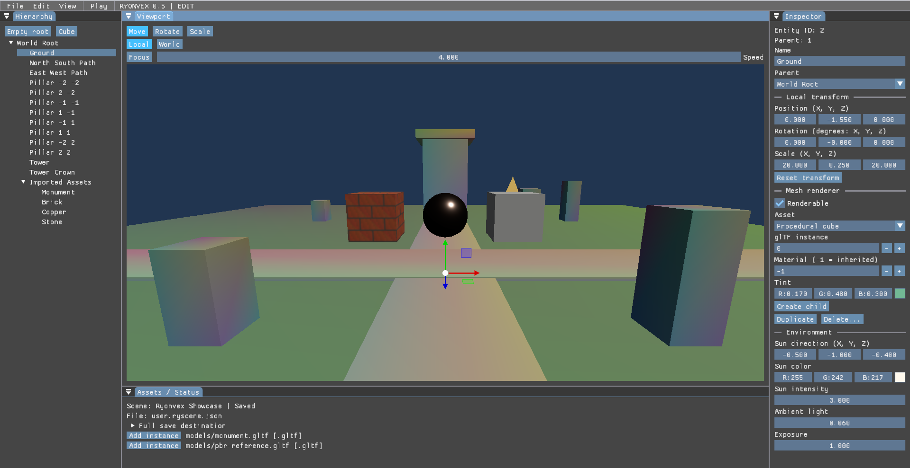

# RYONVEX ENGINE

**Motor gráfico 3D independiente desarrollado en C++20, Vulkan y SDL3.**
## Primera demostración del editor 3D

*Captura real de RYONVEX ENGINE 0.5. Prototipo experimental en desarrollo.*
RYONVEX ENGINE es un proyecto de desarrollo tecnológico centrado en la creación de un motor gráfico 3D propio, con herramientas de edición, renderizado en tiempo real y una arquitectura preparada para evolucionar hacia videojuegos de mayor complejidad.

El proyecto se encuentra en **desarrollo experimental activo**. Nuestro objetivo es construir una base sólida, mejorar progresivamente sus capacidades y reunir una comunidad de desarrolladores interesados en participar en su evolución.

## Tecnologías utilizadas

- **C++20:** lenguaje principal del motor.
- **Vulkan:** API de renderizado gráfico.
- **SDL3:** gestión de ventanas, eventos y entrada.
- **GLM:** operaciones matemáticas para gráficos 3D.
- **Dear ImGui e ImGuizmo:** interfaz del editor y herramientas de transformación.
- **glTF 2.0 / GLB:** importación de modelos 3D estáticos.
- **CMake y CTest:** compilación y pruebas automatizadas.

## ¿Qué hemos desarrollado hasta ahora?

RYONVEX ENGINE ya dispone de una base funcional que incluye:

- Renderizado de escenas tridimensionales mediante Vulkan.
- Gestión de cámara y navegación por escenas.
- Importación de modelos estáticos y materiales PBR básicos.
- Editor visual con jerarquía de entidades e inspector.
- Selección de objetos y herramientas para mover, rotar y escalar.
- Operaciones de deshacer y rehacer.
- Sistemas de escenas y guardado en fase experimental.
- Modos de edición y ejecución diferenciados.
- Pruebas automatizadas y validaciones en Windows.

**Importante:** estas funcionalidades siguen evolucionando. El motor todavía no está preparado para utilizarse como producto comercial.

## Objetivos de desarrollo

Las principales prioridades actuales son:

1. Mejorar la estabilidad del editor y la persistencia de escenas.
2. Reforzar la arquitectura interna, la gestión de recursos y las pruebas.
3. Ampliar las capacidades del renderizador.
4. Optimizar el rendimiento y las herramientas de desarrollo.
5. Incorporar progresivamente nuevos sistemas necesarios para futuros videojuegos.

El desarrollo se organiza por etapas, con especial atención a la calidad del código y la validación de cada avance.

## Buscamos colaboradores

Nos interesa conocer a personas con conocimientos o ganas de contribuir en áreas como:

- Programación de motores en C++.
- Vulkan y programación gráfica.
- Herramientas de edición 3D.
- Arquitectura de software y optimización.
- Pruebas, depuración y documentación técnica.

**La colaboración propuesta es voluntaria y, actualmente, no remunerada.** El alcance y las condiciones de cualquier participación se acordarán antes de comenzar.

## ¿Cómo contactar?

Puedes abrir una **Issue** en este repositorio para presentarte, proponer una mejora o expresar tu interés en colaborar.

Incluye, si es posible, tu área de experiencia y el tipo de contribución que te gustaría realizar.

## Código fuente y disponibilidad

Este repositorio público está dedicado a la **presentación y comunicación del proyecto**.

El código fuente principal de RYONVEX ENGINE permanece en un repositorio privado durante esta etapa de desarrollo. No se distribuyen aquí los archivos internos del motor ni una versión ejecutable pública.

La posible incorporación de colaboradores al desarrollo privado se evaluará individualmente.

---
## Enlaces de la comunidad

- **[Solicitar colaboración](https://github.com/victoresa4/RYONVEX-ENGINE-COMUNIDAD/issues/1)** — Para desarrolladores interesados en participar.
- **[Debates de la comunidad](https://github.com/victoresa4/RYONVEX-ENGINE-COMUNIDAD/discussions)** — Preguntas, ideas y novedades.
- - **[ArtStation — Demostración del editor 3D](https://www.artstation.com/artwork/BaaKyl)** — Primera demostración técnica de RYONVEX ENGINE 0.5.
- **[Guía de colaboración](CONTRIBUTING.md)** — Cómo proponer contribuciones.
- **[Código de conducta](CODE_OF_CONDUCT.md)** — Normas de participación.

**¿Quieres formar parte de RYONVEX ENGINE?** Consulta nuestra guía y preséntate en el anuncio de colaboración.

**RYONVEX ENGINE — Construyendo nuestro propio motor gráfico, paso a paso.**
